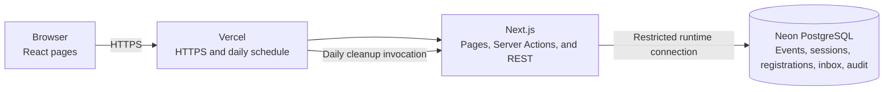

# Final software architecture document

Team 1 · Terrapin Events · ENPM 613 · Fall 2026

## Scope and design baseline

Terrapin Events gives campus groups a shared way to publish events and gives students a consistent way to find and register for them. The prototype covers role-based access, organizer drafts, administrator approval, and registration with a first-in, first-out waitlist. It also includes a published-event directory, sample venue capacity rules, a private simulated inbox, and limited audit logging. The [scope and verification record](../prototype-verification.md#functional-requirements) follows PA2 §1.2 and Table 3. Resource conflict detection, event rejection and resubmission, attendance check-in, reporting, and live notifications are full-system work.

This is the as-built revision of PA3. The original design targets React 18 as a standalone SPA, a Java 21 Spring Boot modular monolith, PostgreSQL, and a two-instance Docker Compose deployment behind Nginx. The as-built design retains PostgreSQL and feature-oriented boundaries. Browser workflows currently execute in Next.js on Vercel. The Spring Boot catalog and shared-session resolver are implemented for optional staging integration.

## Deployment view

Production renders pages and processes mutations through the Next.js application. The [optional staging configuration](../../backend/README.md) lets Next.js call Spring for public listings and venues and resolve existing sessions through a private service endpoint. The Spring process connects to the staging database with dedicated, narrowly granted PostgreSQL identities. The Next.js application remains responsible for issuing and revoking sessions and rechecking authorization for mutations. Vercel deployment protection and Neon project configuration are platform-managed.

## Component and interface view

| Component | Provided interface and dependencies |
| --- | --- |
| Browser presentation | Event directory, event detail, and role-aware workspaces. Forms call Server Actions. |
| HTTP edge and security | Content security policy, standard registration API responses, same-origin checks, readiness probe, and authenticated housekeeping. Delegates business rules to `lib/`. |
| Identity and access | Password verification, sessions, role enforcement, authorization transactions, and audit writes. Spring can optionally resolve existing sessions in staging. |
| Event and approval | Create, edit, submit, approve, publish, and query events. Depends on venue capacity and the shared event lock. |
| Registration and roster | Confirm or waitlist, cancel, promote, change seat capacity, list personal registrations, and serve authorized rosters. Uses the event lock, registration repository, and notifications. |
| Catalog and venue | Public event read queries and a sample venue directory. The catalog composes its read operations from the event service and owns no tables. The venue repository supplies the capacity constraint. |
| Notification and audit | Simulated notices are written in the business transaction. Audit writes use an append-only runtime grant. |
| Persistence | PostgreSQL enforces active-registration uniqueness and valid cancellation state. The runtime role has column-level permissions for sensitive writes. |

The [interface and class mapping](SADD.md) describes the boundary implementation. The [traceability matrix](traceability.md) gives concrete identifiers and evidence for each component and decision.

## Implementation decisions

The prior documents record the intended decisions. This revision records the actual migration and deployment choices, their rationale, and their consequences. Formal course approval of the deviations is unverified.

| Original decision | As-built decision and implications |
| --- | --- |
| D1–D2 · Spring modular monolith and three tiers | **Partial.** Feature services and repositories remain grouped by responsibility. Next.js hosts the browser-facing application and most business logic so the prototype can run on the requested Vercel and Neon stack. Spring implements the public read side and optional session resolution. The target single Java runtime and its enforceable module boundaries remain incomplete. |
| D3 · PostgreSQL and Spring Data JPA | **Partial.** PostgreSQL is the source of truth. Spring catalog reads use JPA and restricted views. Next.js uses parameterized SQL for transactional rules and most reads, and the schema differs from the detailed Java entity model. |
| D4 · Per-event pessimistic seat lock | **Partial.** Next.js locks the existing event row and derives seat availability from active registrations. This serializes competing capacity changes and avoids a redundant seat counter. The separate `EventSeat` entity is deferred. |
| D5 · Transactional outbox and retry worker | **Deviation.** The simulated inbox entry is written to the same PostgreSQL transaction as the registration. This gives atomicity for in-app notices with no external delivery dependency. There is no durable retry queue or independent delivery stage. |
| D6 · Stateless servers and shared Spring Session JDBC | **Partial.** Instances share PostgreSQL session rows. Argon2id satisfies SRS NFR-9. Spring optionally resolves and renews the existing tokens. Login, revocation, and write enforcement remain in Next.js. Spring Session JDBC and the specified bcrypt identity adapter are open. |
| D7 · Standalone React SPA over REST | **Deviation.** The shipped React UI uses Next.js server rendering and Server Actions. Registration, registration cancellation, and roster also have REST interfaces. Several documented endpoints are realized through actions or server-rendered views only. |
| D8 · Simulated notifications behind an adapter | **Partial.** The prototype exposes private inbox notices. Module callers use the notification service, but there is no configurable external channel or interchangeable retry worker. |
| PA3 §3.2.4 · Nginx, two containers, separate backup | **Deviation.** Vercel and Neon supply a working hosted environment. The original topology, two-instance failover exercise, and operating backup program require separate evidence. |

## Quality assessment

The strongest evidence covers registration integrity, role isolation, session revocation, and the transition from waitlist to confirmation. Under the [P-1 protocol](../../tests/browser/mvp-api.spec.js), 50 concurrent requests contested one seat and the database retained one confirmation and 49 FIFO waitlist entries. Under the roster portion of P-3, unauthorized requests returned 401 or 403, recorded an audit entry, and left registrations unchanged.

The [verification record](../prototype-verification.md#nonfunctional-requirements) documents partial or open quality claims, including hosted registration response time, scheduled backup and realistic recovery, longer audit retention, human-participant usability, and manual WCAG verification.
