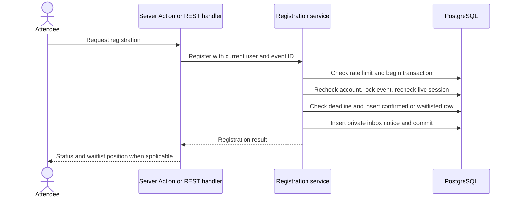

# Final software architecture and detailed design

Team 1 · Terrapin Events · ENPM 613 · Fall 2026

This as-built revision of PA4 describes the implementation frozen for review. Class names from the course design appear next to the functions, modules, and Java classes that perform their responsibilities. The [final SAD](SAD.md) records changes to the target architecture.

## Internal responsibilities

| PA4 responsibility | Implementation |
| --- | --- |
| `AuthenticationService`, `AccessPolicy`, and `AccountService` | [`lib/auth.js`](../../lib/auth.js) contains `authenticate`, `currentUser`, `requireRole`, `authorizedTransaction`, and `updateAccount`. Password operations are in [`lib/password.js`](../../lib/password.js). Token digests, expiration, and account status are shared in PostgreSQL. |
| `EventService` and `ApprovalService` | [`lib/event/service.js`](../../lib/event/service.js) uses `saveDraft`, `changeEvent`, and the approval queries. SQL in [`lib/event/repository.js`](../../lib/event/repository.js) reads and mutates event state and obtains the lock. |
| `RegistrationService`, `RosterService`, and `WaitlistPromotionPolicy` | [`lib/registration/service.js`](../../lib/registration/service.js) exposes `register`, `cancelRegistration`, `updateCapacity`, and `roster`. [`lib/registration/repository.js`](../../lib/registration/repository.js) selects the earliest active waitlist rows, updates statuses, and reads rosters in an authorization-aware query. |
| `EventSearchService` and venue capacity checks | [`lib/catalog/service.js`](../../lib/catalog/service.js) exposes `publicEvents` and `getEvent`. [`lib/venue/service.js`](../../lib/venue/service.js) exposes `venues` and `capacityFitsVenue`. Spring has a separate read-only [catalog controller, service, and repository](../../backend/src/main/java/edu/umd/cems/catalog/). |
| `NotificationService` and `AuditLogger` | [`notify` and `inbox`](../../lib/notification/service.js) write transactional inbox notices and read the current account’s notices. [`audit`](../../lib/auth.js) writes audit rows. [Runtime grants](../../lib/runtime-grants.sql) give the app audit insert privileges. |
| Health and scheduling | [Readiness](../../app/api/health/route.js) checks PostgreSQL. [The cron handler](../../app/api/cron/cleanup/route.js) authorizes a daily Vercel request and calls [`cleanupExpired`](../../lib/maintenance.js) to delete bounded batches of expired sessions and stale rate-limit rows. |

## Realized interfaces

| Interface | Entry point | Contract |
| --- | --- | --- |
| Next.js browser workflows | [`app/page.js`](../../app/page.js) and [`app/actions.js`](../../app/actions.js) | Role-aware pages and actions for sign-in, accounts, events and approvals, registration, and the inbox. Protected writes recheck role and session state in PostgreSQL. |
| `POST /api/events/{id}/registrations` | [Registration route](../../app/api/events/%5Bid%5D/registrations/route.js) | A same-origin authenticated attendee request returns 201 with the registration ID, status, and waitlist position when applicable. |
| `DELETE /api/registrations/{id}` | [Cancellation route](../../app/api/registrations/%5Bid%5D/route.js) | A same-origin owner may cancel an active registration before the event starts. The response is 200 with the same registration ID and cancelled status. |
| `GET /api/events/{id}/roster` | [Roster route](../../app/api/events/%5Bid%5D/roster/route.js) | The owning organizer or an administrator receives active roster rows. Fields include name, email, status, and registration time. |
| Spring `GET /api/events`, `GET /api/events/{id}`, and `GET /api/venues` | [`CatalogController`](../../backend/src/main/java/edu/umd/cems/catalog/CatalogController.java) | Public read-only published event and venue data. The optional Next.js staging bridge uses the list and venue interfaces. |
| Spring `POST /internal/session/resolve` | [`SessionController`](../../backend/src/main/java/edu/umd/cems/identity/SessionController.java) | Optional internal staging interface. Validates the service credential and resolves an existing hashed session. |

The registration and roster REST handlers share the UI’s feature services. [`apiFailure`](../../app/api/respond.js) maps domain and database failures to the common JSON error shape. PA4 Table 15 also specifies account, event-write, approval, personal registration, and inbox REST contracts. In the current Next.js implementation those operations are handled through browser actions and pages. Password reset, event rejection or cancellation, resource management, check-in, reports, audit browsing, and roster export are full-system or deferred operations.

## Registration sequence and data invariants

- **Event state.** A draft can become pending and a pending event can become published. Submission serializes the owner’s pending count and limits it to five. Capacity changes must fit the venue and cover the confirmed count.
- **Registration state.** A registration is confirmed, waitlisted, or cancelled. Cancelled rows carry a timestamp and remain in history. A partial unique index allows only one active entry per attendee and event. Re-registration creates a new row.
- **Concurrency.** The event row is the seat lock. Under that lock, cancellation releases a confirmed seat and promotes the first active waitlist row by insertion ID. The UI verifies the registration ID and displayed status, so a stale confirmation cannot cancel a replacement or newly promoted seat.
- **Privacy.** Roster queries combine authorization and data retrieval in PostgreSQL. Inbox and personal registration queries use the authenticated account ID. Authorization and session revocation are checked again before writes commit.
- **Schema ownership.** [`schema.sql`](../../lib/schema.sql) defines accounts, sessions, venues, events, registrations, notifications, rate limits, and audit entries. [Spring grants](../../backend/sql/) expose restricted catalog views and session resolution. Provider credentials are injected outside the source tree.

## Design principles and patterns

| Principle or pattern | Evidence and limits |
| --- | --- |
| Single responsibility | Route handlers translate HTTP, services apply feature rules, and repositories issue SQL. The [event](../../lib/event/) and [registration](../../lib/registration/) packages show this split. Browser presentation still lives predominantly in one page module. |
| Open/closed | The app can select the Spring catalog with configuration while preserving the directory UI contract. The notification system still has one simulated implementation and lacks the planned plug-in channel. |
| Liskov substitution | [`springDirectory`](../../lib/spring-catalog.js) returns the normalized directory contract used by the same Explore view, and [browser tests](../../tests/browser/spring-catalog.spec.js) cover shared behavior and outage handling. Java subtype substitution across the broader PA4 design remains unverified. |
| Interface segregation | Public catalog consumers receive limited read DTOs. The internal resolver exposes one restricted operation. Neither needs the organizer write surface or database-owner privileges. |
| Dependency inversion | The Next.js view calls feature services and the Spring bridge isolates its HTTP dependency. The Java catalog uses constructor-injected collaborators. The Next.js feature modules still import concrete repositories and services, so inversion is partial. |
| Repository and unit of work | Event and registration SQL are in repository modules. [`transaction`](../../lib/db.js) owns commit and rollback, and feature code passes one database client through related changes. |
| Pessimistic concurrency and explicit state transitions | [`eventTransaction`](../../lib/event/seat-lock.js) applies the row lock. [Constraints and indexes](../../lib/schema.sql) enforce registration state and uniqueness. The PA4 separate seat entity, Strategy interface, and transactional outbox are deferred. |

See the [traceability matrix](traceability.md) for the corresponding SRS requirements, verification cases, and dispositions.
